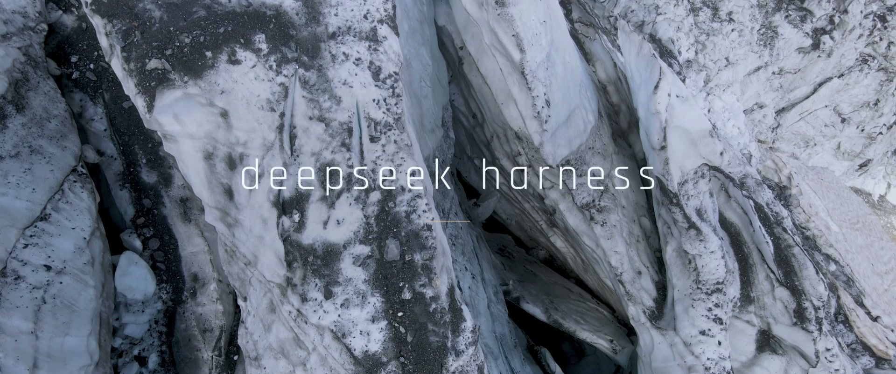

# 冰川航拍 · deepseek harness

给 DeepSeek Harness 制作的电影感启动动画：冰川实拍、连续航拍运镜、完整 `deepseek harness` 字标，以及标题显现时的低音铜管、低频冲击和立体声混响。成片 23 秒，1920×804，30 fps。



[观看 B 站完整版](https://www.bilibili.com/video/BV1eKW76vEgf/) · [下载完整安装包](https://github.com/hmirror123/deepseek-harness-icebreak/releases/latest) · [宿主插件 dsh-boot-suite](https://github.com/LeeRolling/dsh-boot-suite)

## 与 dsh-boot-suite 的关系

**这是 `dsh-boot-suite` 的用户启动模板扩展包，依赖已经安装并启用的宿主插件。** 本项目通过它的 iframe 模板接口接入 DeepSeek Harness，安装后显示在「设置 → 启动动画」的模板列表中。

| 部分 | 提供的功能 |
| --- | --- |
| DeepSeek Harness | 桌面应用本体 |
| [dsh-boot-suite](https://github.com/LeeRolling/dsh-boot-suite)，作者沈宏宏 · LeeRolling | 启动动画设置入口、用户模板发现、播放生命周期与返回主界面 |
| 本仓库 | 23 秒成片、独立 iframe 播放页、模板描述，以及安装和卸载脚本 |

本项目采用 `DSH_HOME/startup-templates/deepseek-harness-icebreak/` 用户模板目录接入；不是另一个需要加入 Cordis profile 的 npm 插件。`extension.json` 是本扩展的分发清单，不是独立插件的 `package.json`。宿主 `dsh-boot-suite` 由其上游项目单独安装、更新和管理。

## 安装

要求 Windows、已经初始化的 DeepSeek Harness Desktop profile、**已安装并启用的 dsh-boot-suite ≥ 2.16.7**，以及 Node.js 20 或更高版本。启动器优先使用 PATH 中的 Node，其次查找 DeepSeek Harness primary runtime。桌面预览验证使用的宿主版本为 **2.16.11**。

1. 按 [dsh-boot-suite 上游说明](https://github.com/LeeRolling/dsh-boot-suite#安装)安装并启用宿主。
2. 从本仓库 [Releases](https://github.com/hmirror123/deepseek-harness-icebreak/releases/latest) 下载 **`deepseek-harness-icebreak-1.2.0.zip`**，解压。
3. 双击包内的 **`install.cmd`**。
4. 完全退出 DeepSeek Harness（包括托盘），再打开。在「设置 → 启动动画」中，第一幕应为 **「冰川航拍 · deepseek harness」**，第二幕为「不播放」。

播放结束后自动进入应用，按 **Esc** 可跳过。安装时保留用户的原有播放频率，例如「每个浏览器会话一次」。

**请下载 Release 的完整安装包。** GitHub 的 `Code → Download ZIP` 和 `git clone` 提供源码，不含成片 MP4；完整安装包包含视频，解压即可安装。

安装器依次读取当前进程的 `DSH_HOME`、Windows 用户环境变量 `DSH_HOME`，最后回退到 `%USERPROFILE%\.dsh`。自定义目录可手动指定：

```powershell
./Launch.ps1 -DshHome 'D:/DeepSeekHarness/dsh-home'
```

也可直接调用 Node 安装器：

```powershell
node ./install.mjs --home 'D:/DeepSeekHarness/dsh-home'
```

## 安装会修改什么

安装器校验视频 SHA-256，将本扩展复制到 `DSH_HOME/startup-templates/deepseek-harness-icebreak/`，并在该目录保存 `icebreak-install-state.json` 配置备份。

`DSH_HOME/dsh-startup.json` 中的第一幕切换为本模板，第二幕设为 `none`，速度设为 1，启用自动播放与 Esc 跳过，关闭交互确认、底噪和额外 BGM，并设置第一幕视频原声字段。用户原有的播放频率及其余配置保留。宿主插件文件和应用二进制不需要修改。

模板播放页使用不透明 Canvas 呈现已解码的视频帧，缓冲期间保留上一帧，并由视频结束事件触发退出。安装器将影片嵌入播放页，再在页面内创建本地 Blob，兼容桌面版的本地协议和模板沙箱。

声音已经合入影片；iframe 播放页自行播放原声，宿主针对原生视频图层的音量开关不接入本播放页。浏览器阻止有声自动播放时，会回退到静音。加载失败或长时间停滞会自动退出。

## 卸载与更新

双击 **`uninstall.cmd`**，或者运行：

```powershell
./Launch.ps1 -Action uninstall -DshHome 'D:/DeepSeekHarness/dsh-home'
```

卸载会移除此模板，并将仍保持安装时取值的配置字段恢复到备份值；之后手动改过的字段会保留。宿主 `dsh-boot-suite` 继续由它自己的插件管理流程管理。

更新时解压新版完整安装包，再运行其中的 `install.cmd`。安装器保留配置恢复记录，并对复制、替换或写配置失败执行回滚。

## 从源码开发与打包

把完整 Release 包中的 `template/assets/icebreak.mp4` 复制到源码的相同位置，然后运行：

```powershell
node --test ./tests/install.test.mjs
node ./tools/build-release.mjs
```

打包命令在 Windows 上使用 PowerShell 生成 `dist/deepseek-harness-icebreak-1.2.0.zip` 和对应 SHA-256 文件。Git 仓库不追踪成片视频和构建产物；Release 安装包含全部运行文件。

主要文件：`template/template.json` 定义宿主入口，`template/index.html` 实现播放器，`install.mjs` 管理安装、备份和卸载，`extension.json` 记录视频规格及校验码。

安装器测试覆盖安装/重装/卸载、用户配置保留、版本检查、并发安装锁、模板归属保护、缺少影片的源码包，以及含空格的 Windows 路径。播放验证覆盖完整时长、自动返回、Esc 跳过、保帧和沙箱媒体加载；硬件、驱动和宿主版本变化仍可能影响实际表现。

## 许可与鸣谢

项目代码采用 [MIT License](LICENSE)。冰川画面来自 **Florian Delée / Pexels**，字体为 **Indian Type Foundry 的 Rajdhani**；第三方画面与字体分别遵循 **Pexels License** 和 **SIL OFL 1.1**，不重新授权为 MIT。成片已加入剪辑、调色、动态字标及原创声音设计。

完整来源、许可链接与字体许可副本见 [CREDITS.md](CREDITS.md) 和 [licenses/Rajdhani-OFL.txt](licenses/Rajdhani-OFL.txt)。感谢 **LeeRolling / dsh-boot-suite** 提供用户模板接口。本项目为社区扩展，与 DeepSeek、Pexels 及宿主作者之间无官方背书关系。
